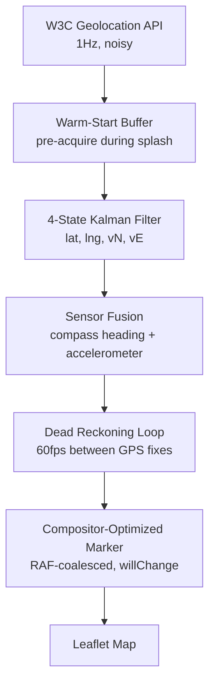

<div align="center">
  

# Minnesota Then: Museum Without Walls

**Independent public history for Minnesota: a browser-based location engine that brings historical exhibits to the places where they happened.**

[](LICENSE-MPL)
[](https://creativecommons.org/licenses/by-nc/4.0/)
[](#privacy)
[](#installable-web-app)

[Website](https://www.mnthen.com) · [Open the Map](https://mnthen.com/mnthen_welcome.html) · [History Trivia](https://mnthen.com/trivia.html) · [Sponsor](https://www.mnthen.com/sponsors.html) · [Support](https://buymeacoffee.com/minnesotathen)

</div>

---

## Overview

No app store. No signup to explore. Your location stays on your device. Just a browser, doing things browsers aren't supposed to be able to do.

Minnesota Then is a public history and publishing project. Its centerpiece is a walking map that unlocks photographs, narration, and stories as you reach historical sites. The map runs on a custom real-time sensor fusion pipeline built with the W3C Geolocation API, the device compass, and the accelerometer, with no native code and no Mapbox or Google Maps SDKs.

## The Project

| Part | What it offers |
|------|----------------|
| **[Interactive Map](https://mnthen.com/mnthen_welcome.html)** | A free, location-based museum. No account needed. |
| **[History Trivia](https://mnthen.com/trivia.html)** | A free Minnesota history game with guest play and an optional leaderboard account |
| **[Articles](https://mnthen.com/blog.html)** and **[Newsletter](https://mnthen.substack.com)** | Researched stories about Minnesota people, places, and events |
| **[Books](https://www.mnthen.com/slo-is-pro.html)** | Publications from Minnesota Then Press, including *Slo Is Pro* |
| **[Sponsorship](https://www.mnthen.com/sponsors.html)** | Clearly labeled opportunities that help fund the work |

---

## What the Map Does

1. **Walk up to a historical site.** The engine detects proximity within about 6 meters (20 feet).
2. **Unlock rich multimedia.** Archival photos, audio narration, and curated stories appear.
3. **Move on.** The engine tracks you to the next site with smooth, drift-resistant positioning.

Positioning is processed on your device. Your location history never leaves your phone.

---

## The Positioning Engine

Many location apps place a marker on top of `navigator.geolocation.watchPosition` and stop there. This engine goes further.

> [!IMPORTANT]
> Real-time Kalman filtering, dead reckoning, and sensor fusion, written in vanilla JavaScript.

### Core Pipeline



### What That Solves

| Problem | Standard Web App | Minnesota Then |
|---------|------------------|----------------|
| **GPS updates at 1Hz** | Marker freezes between fixes | Dead reckoning predicts position at 60fps using velocity vectors |
| **Standing still, yet drifting** | GPS noise makes you wander | Accelerometer-gated freeze with hysteresis |
| **Cold-start lag** | 3–10 seconds to first fix | Warm-start acquisition during the splash screen |
| **iOS geolocation quirks** | Broken audio, ghost clicks, permission timing | Handled explicitly |
| **Background and foreground** | Full re-initialization | Stateful resume with velocity seeding |
| **Stationary-to-movement lag** | Filter resists tracking for about 1s | Velocity variance pre-boost on breakout detection |
| **Zoom oscillation** | Jumps between zoom levels | Priority-based zoom controller with lock durations |

<details>
<summary><strong>Deep Dive: Technical Stack and Architecture</strong></summary>

**Dependencies:** Leaflet.js, Bootstrap, Font Awesome  
**Custom code:** About 2,800 lines of positioning pipeline

**Core modules:**
- `PositionKalmanFilter`: 4-state EKF with adaptive process noise, reference frame shifting, velocity seeding, and gap recovery
- `SensorFusionManager`: Device orientation (compass) and accelerometer integration with permission gating
- `DeadReckoning`: RAF-based predictive loop with speed-scaled horizon and drift thresholds
- `ModeManager`: Speed-based mode transitions (roaming ↔ centered) with pending-state elimination of split-brain windows
- `ZoomController`: Zero-GC priority queue for smooth zoom authority
- `LocationCooldownManager`: Per-location visit gating with proximity-aware auto-reopen

**Browser APIs used:**
- `navigator.geolocation` (high-accuracy `watchPosition`)
- `DeviceOrientationEvent` and `DeviceOrientationAbsoluteEvent` (compass)
- `Accelerometer` (Generic Sensor API, permission-gated)
- `WakeLock` (screen stays on during audio playback)
- `MediaSession` (lock-screen audio controls)
- `ServiceWorker` (update lifecycle management, not positioning)

</details>

<details>
<summary><strong>Performance Characteristics</strong></summary>

- **Marker updates:** RAF-coalesced and compositor-layer promoted
- **GPS power scaling:** `maximumAge` and `timeout` adapt to movement state (stationary: 5s/20s, driving: 1s/10s)
- **Memory:** Tracked timeout registry, cleanup on `pagehide`, WeakMap-based deduplication
- **Background:** 30s fix throttling with full state preservation

</details>

### Why No Framework?

The positioning pipeline runs at 60fps with sub-16ms frame budgets. Adding a virtual DOM reconciliation layer would introduce unpredictable garbage collection pauses and make RAF scheduling unreliable. Every allocation is intentional: the Kalman filter reuses matrix buffers, the zoom controller uses a Map instead of arrays, and all timers are tracked for leak-free cleanup. The engine is plain JavaScript IIFEs, with no build step, bundler, or framework overhead.

---

## The Museum Experience

1. **Discovery:** Navigate to marked historical sites across Minnesota.
2. **Proximity unlock:** Content appears automatically within about 20 feet.
3. **Audio docent:** Narrated history with background-aware playback recovery.
4. **Deep context:** Archival photos, source citations, and difficulty ratings.
5. **Continue:** A cooldown system prevents re-triggering while the engine finds the next site.

### Content Features

- Custom marker clustering with tour-type color coding
- Progressive image preloading based on proximity
- Tile prefetching at target zoom levels
- Responsive audio player with scrubbing, MediaSession integration, and interruption recovery
- Accessibility-first design: screen reader announcements, keyboard navigation, and focus management

### Installable Web App

- Installable to the home screen (iOS Safari, Android Chrome, desktop)
- Standalone display mode with theme-color integration
- Post-install guidance
- Graceful degradation between installed and browser-tab use

---

## History Trivia

The [trivia game](https://mnthen.com/trivia.html) is a single page backed by Firebase Authentication and Realtime Database.

- Guest play with no account; guest scores are not saved
- Optional accounts with email verification and self-service deletion
- A neutral age screen before signup; accounts are for people 13 and older
- A public leaderboard showing first name, last initial, optional display name, scores, and games played
- Labeled sponsor breaks between rounds
- Score sharing to social networks and email

---

## Privacy

| Area | What happens |
|------|--------------|
| **Map** | No account. Location, compass, and motion data are processed on your device and not sent to us. Anonymous visit, view, and like totals may be recorded. |
| **Trivia** | Accounts are optional. Account holders appear on the public leaderboard. |
| **Website** | Many pages use Google Analytics, which is not loaded when your browser sends a Do Not Track signal. |
| **Sponsors** | No ad networks and no sale of personal information. |

Read the full [Privacy Policy and Terms of Service](https://www.mnthen.com/privacy_terms.html).

---

## Getting Started

```bash
git clone https://github.com/mreicher/MNThen.git
cd MNThen

# Serve with any static file server
python -m http.server 8000
# Or: npx serve .
```

Then open `http://localhost:8000`.

**Requirements:**
- A modern browser with Geolocation API support
- HTTPS (except on `localhost`) for sensor APIs
- Location permission

> [!NOTE]
> **Running your own copy?** Use your own Firebase project and security rules, replace or remove the Google Analytics ID, and swap out Minnesota Then branding, sponsor content, and contact details.

---

## Project Structure

```
MNThen/
├── index.html              # Homepage
├── mnthen_welcome.html     # Entry point to the interactive map
├── trivia.html             # History trivia game
├── sponsors.html           # Sponsorship opportunities
├── slo-is-pro.html         # Book page
├── privacy_terms.html      # Privacy Policy and Terms of Service
├── css/
│   ├── mainmap.css         # Map styling
│   └── mnthen_main_map2.css
├── js/
│   └── locations_main.js   # Location data (content, coordinates, media URLs)
├── images/
├── manifest.json           # PWA manifest
└── sw.js                   # Service worker (update management)
```

---

## Supporting the Project

- **Sponsor:** Support a location, story, community project, or trivia break on the [sponsors page](https://www.mnthen.com/sponsors.html). Sponsors do not control research, conclusions, or wording.
- **Contribute:** Make a one-time or recurring gift through [Buy Me a Coffee](https://buymeacoffee.com/minnesotathen).
- **Follow:** Subscribe to the [newsletter](https://mnthen.substack.com).
- **Correct us:** Found a historical error or a bug? Open an issue or send an email.

---

## License

This project uses a dual-license structure. Please make sure you understand the boundaries between code and content.

> [!CAUTION]
> ### Code: Mozilla Public License 2.0
> The positioning engine, UI components, and all JavaScript/CSS in this repository are licensed under MPL-2.0.
> - You can use, modify, and distribute the code.
> - Modifications to existing files must be shared under MPL-2.0 when you distribute them.
> - New files you add can be under another license.
> - Patent rights are granted to users.
>
> *See [LICENSE-MPL](LICENSE-MPL) for the full text.*

> [!WARNING]
> ### Content: CC BY-NC 4.0
> Historical articles, audio narration, images, location descriptions, and curated stories are licensed under [Creative Commons Attribution-NonCommercial 4.0 International](https://creativecommons.org/licenses/by-nc/4.0/).
> - **Attribution:** Credit Minnesota Then and the original creator, link to the license, and indicate any changes.
> - **NonCommercial:** No commercial use without explicit permission.
>
> *This applies to content in `js/locations_main.js`, `images/`, and referenced audio files, except as listed below.*
>
> **Not covered by either license above:**
> - Books and other publications from Minnesota Then Press, which are protected by copyright
> - Material owned by others, including credited photographs and recordings
> - Sponsor names, logos, and artwork
>
> **Commercial licensing inquiries:** [mattreicher@protonmail.com](mailto:mattreicher@protonmail.com)

---

## Acknowledgements

- **Minnesota Historical Society:** Archival data and photographs
- **Metropolitan State University:** Research methodology
- **OpenStreetMap:** Map tiles (© OpenStreetMap contributors)
- **Leaflet.js:** Mapping library
- **All contributors:** Researchers, testers, and developers

## Contact

[mattreicher@protonmail.com](mailto:mattreicher@protonmail.com)

